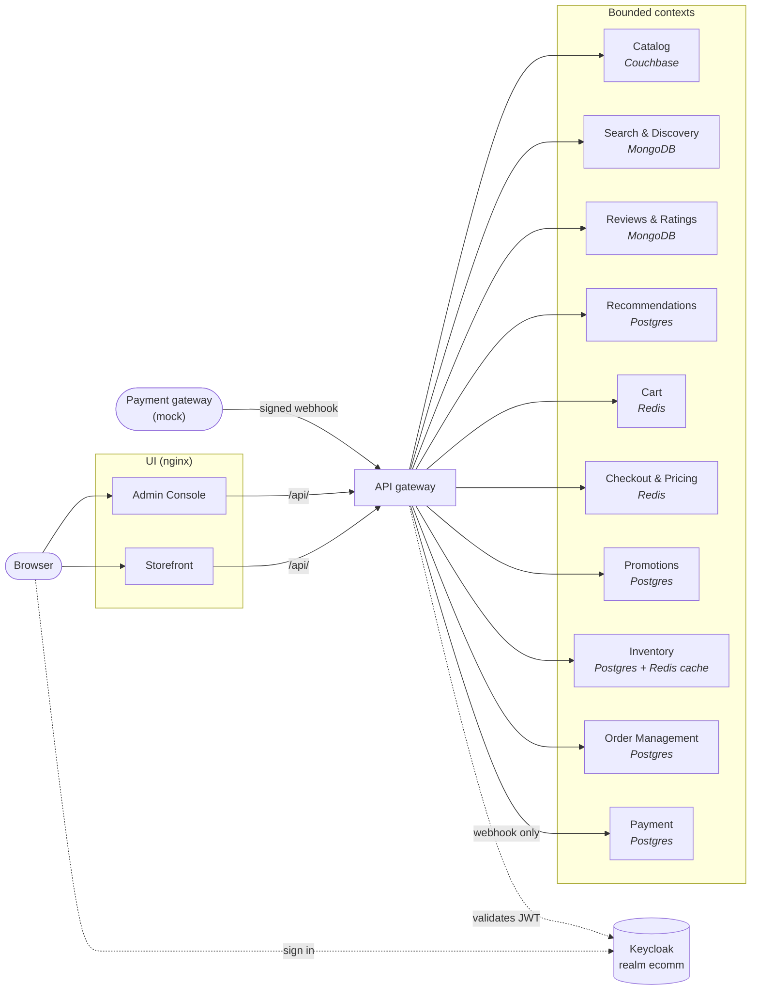
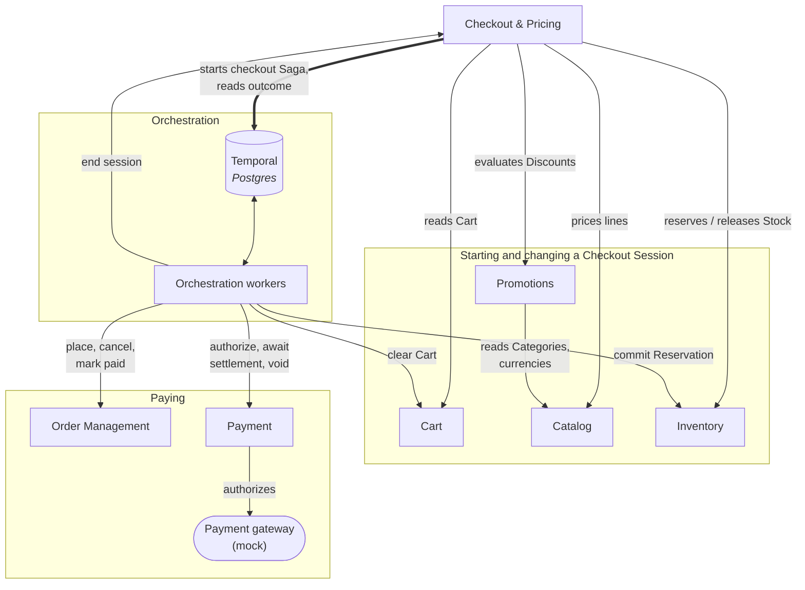
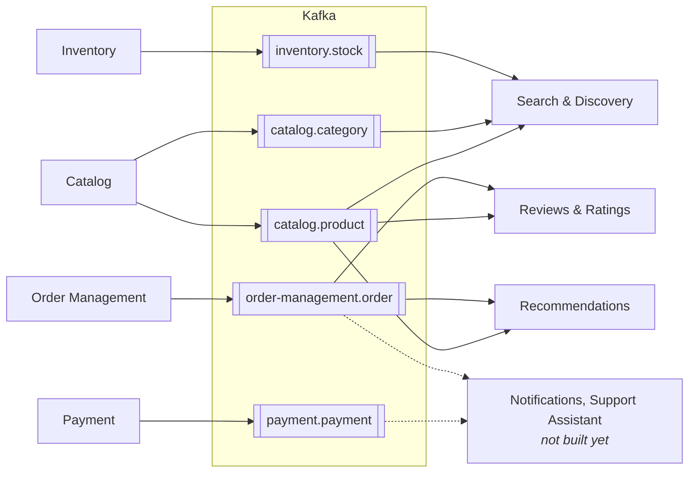
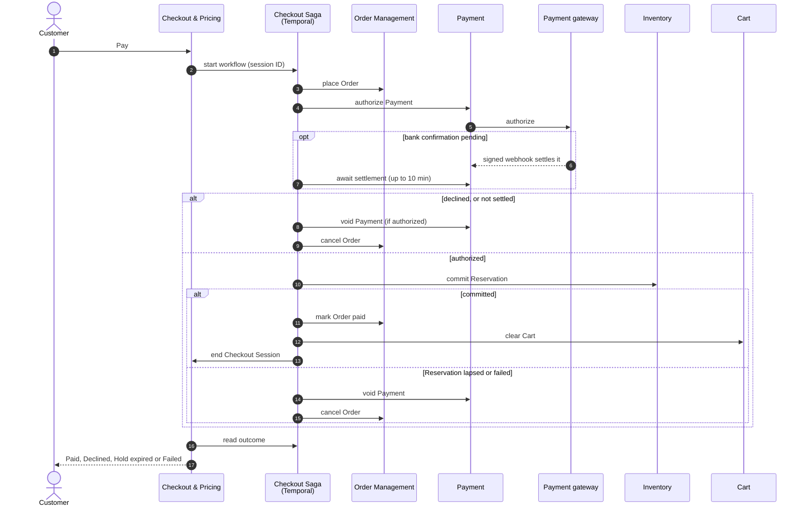

# Architecture

Four views of the running stack as of Sprint 4: how browsers reach the services, how the contexts
call each other, what flows over Kafka, and how the checkout Saga pays for a Checkout Session. [`GLOSSARY-MAP.md`](../GLOSSARY-MAP.md) is the
source of truth for the relationships. Update these diagrams when a relationship there changes.

## Requests

Browsers reach the services only through the API gateway, which rejects a missing or invalid token
at the edge ([ADR 0010](./adr/0010-api-gateway-authenticates-at-the-edge.md)). Every service still
checks the Keycloak-issued JWT itself. Each service shows the store it owns. The gateway routes
nothing to Payment except the payment gateway's webhook.

## Calls between contexts

Contexts call each other's internal endpoints, which the gateway never routes, each with its own
client-credentials identity
([Identity ADR 0002](../services/identity-access/docs/adr/0002-service-identity-by-client-credentials.md)).
Checkout calls four contexts to start and change a Checkout Session, and starts the checkout Saga
to pay one. The Saga's workers then send each step's command.

## Events

Every event is published from its context's outbox to a compacted topic named after its schema
in [`platform/event-schemas`](../platform/event-schemas/)
([ADR 0002](./adr/0002-ledgers-and-outboxes-not-event-sourcing.md),
[ADR 0006](./adr/0006-kafka-as-single-event-backbone.md)). Consumers keep the newest version of
each entity and never call the publisher. Each consumer group, listed in
[`infra/docker/consumer-groups`](../infra/docker/consumer-groups), has its own `<group>.dlt` and
`<group>.redrive` topics. Commands never travel over Kafka.

## Paying a Checkout Session

Paying starts the checkout Saga on Temporal, with the session's ID as the workflow's ID
([ADR 0009](./adr/0009-sagas-on-temporal.md)). Checkout already holds the Cart's Stock in a
Reservation. The Saga compensates a failure by voiding an authorized Payment and cancelling the
Order. Clearing the Cart and ending the session come after the Order is paid. If either fails,
the failure is logged and the Order stays paid.

## Not built yet

Fulfillment & Shipping, Returns & Warranty, Notifications and the AI Support Assistant are
planned in [`docs/roadmap.md`](./roadmap.md). The fulfillment and returns Sagas will run in
Orchestration beside the checkout Saga. Prometheus and Grafana scrape every service and are left
out of the diagrams.
