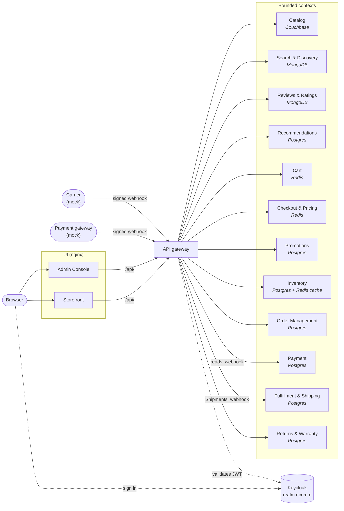
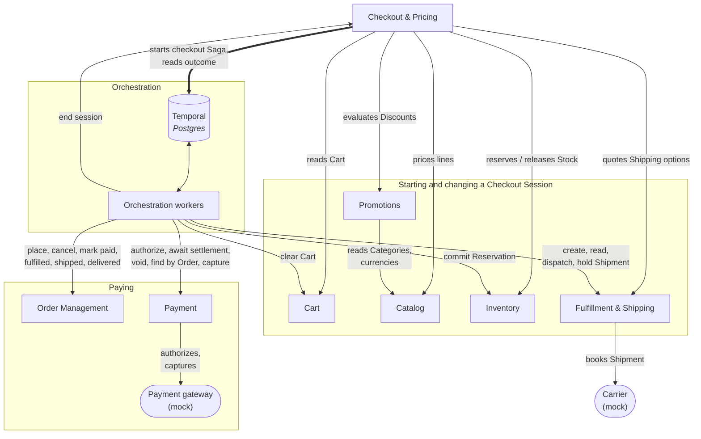
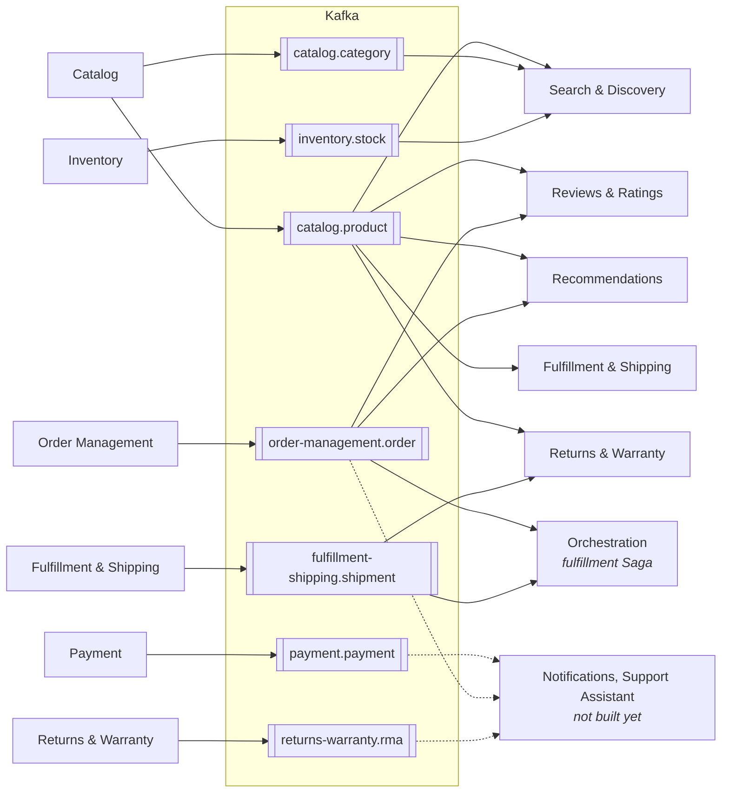
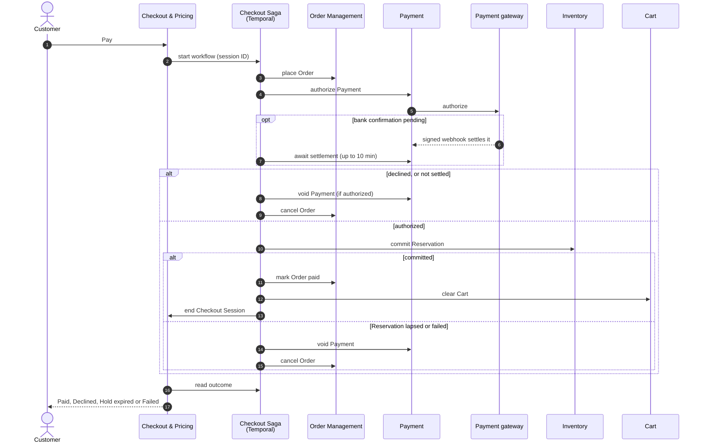
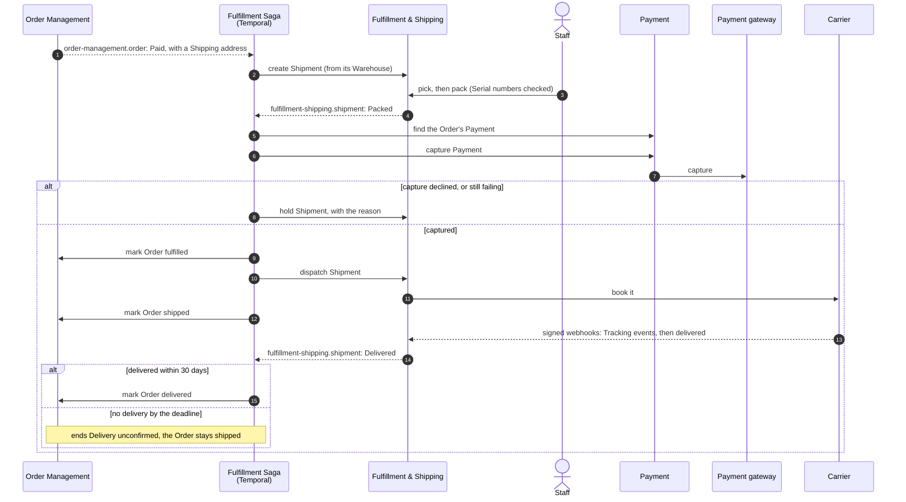

# Architecture

Five views of the running stack as of Sprint 5: how browsers reach the services, how the contexts
call each other, what flows over Kafka, how the checkout Saga pays for a Checkout Session, and how
the fulfillment Saga takes a paid Order to its Customer. [`GLOSSARY-MAP.md`](../GLOSSARY-MAP.md) is the
source of truth for the relationships. Update these diagrams when a relationship there changes.

## Requests

Browsers reach the services only through the API gateway, which rejects a missing or invalid token
at the edge ([ADR 0010](./adr/0010-api-gateway-authenticates-at-the-edge.md)). Every service still
checks the Keycloak-issued JWT itself. Each service shows the store it owns. The gateway routes
Payment's reads by Customers and Staff, and the payment gateway's signed webhook, but none of the
commands only Orchestration makes. The Carrier's signed webhook reaches Fulfillment & Shipping the
same way, without a token.

## Calls between contexts

Contexts call each other's internal endpoints, which the gateway never routes, each with its own
client-credentials identity
([Identity ADR 0002](../services/identity-access/docs/adr/0002-service-identity-by-client-credentials.md)).
Checkout calls five contexts to start and change a Checkout Session, and starts the checkout Saga
to pay one. Orchestration starts the fulfillment Saga itself, from a paid Order's event. The Sagas'
workers then send each step's command.

## Events

Every event is published from its context's outbox to a compacted topic named after its schema
in [`platform/event-schemas`](../platform/event-schemas/)
([ADR 0002](./adr/0002-ledgers-and-outboxes-not-event-sourcing.md),
[ADR 0006](./adr/0006-kafka-as-single-event-backbone.md)). Consumers keep the newest version of
each entity and never call the publisher. Each consumer group, listed in
[`infra/docker/consumer-groups`](../infra/docker/consumer-groups), has its own `<group>.dlt` and
`<group>.redrive` topics. Commands never travel over Kafka.

Fulfillment & Shipping and Returns & Warranty appear twice, as a publisher on the left and a
consumer on the right, to keep the arrows one way. Orchestration consumes `order-management.order`
to start a paid Order's fulfillment Saga, and `fulfillment-shipping.shipment` to wake it; it
publishes nothing.

## Paying a Checkout Session

Paying starts the checkout Saga on Temporal, with the session's ID as the workflow's ID
([ADR 0009](./adr/0009-sagas-on-temporal.md)). Checkout already holds the Cart's Stock in a
Reservation. The Saga compensates a failure by voiding an authorized Payment and cancelling the
Order. Clearing the Cart and ending the session come after the Order is paid. If either fails,
the failure is logged and the Order stays paid.

## Fulfilling a paid Order

A `Paid` Order with a Shipping address starts its fulfillment Saga, `fulfillment:<orderId>`, once
however often its event is delivered ([ADR 0009](./adr/0009-sagas-on-temporal.md)). Staff pick and
pack the Shipment in the Admin Console; the Saga waits for each change on
`fulfillment-shipping.shipment`, and reads the Shipment again now and then in case an event never
comes. The Payment is captured only once the Shipment is packed. Once it is captured nothing is
compensated: each later step is retried until it succeeds. A declined capture holds the Shipment
for good and leaves the Order `Paid`.

Returns & Warranty takes a Customer's RMA, a return within the Return Period or a warranty claim
within the Warranty Window, only against units its projection of `fulfillment-shipping.shipment`
shows were delivered. Staff approve or reject it in the Admin Console. No Saga drives an RMA yet.

## Not built yet

Notifications, the AI Support Assistant and the returns Saga are planned in
[`docs/roadmap.md`](./roadmap.md). The returns Saga will run in Orchestration beside the checkout
and fulfillment Sagas, refunding through Payment and restocking through Inventory. Prometheus and
Grafana scrape every service and are left out of the diagrams.
