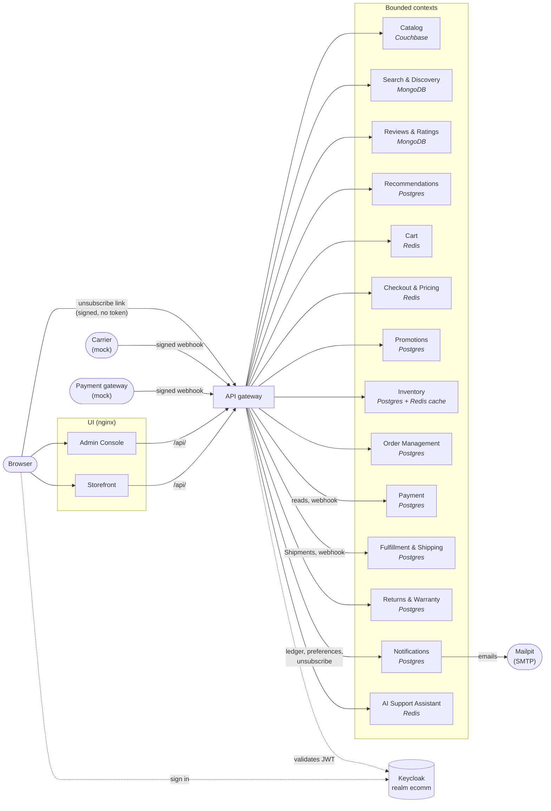
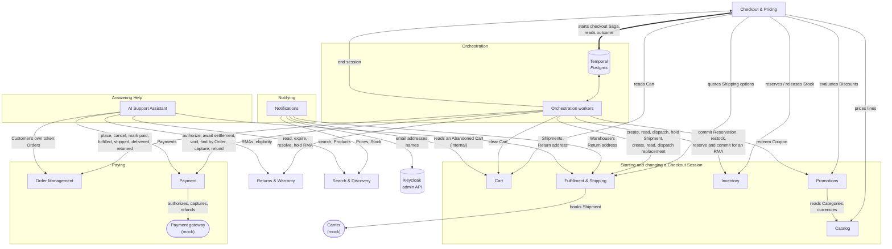
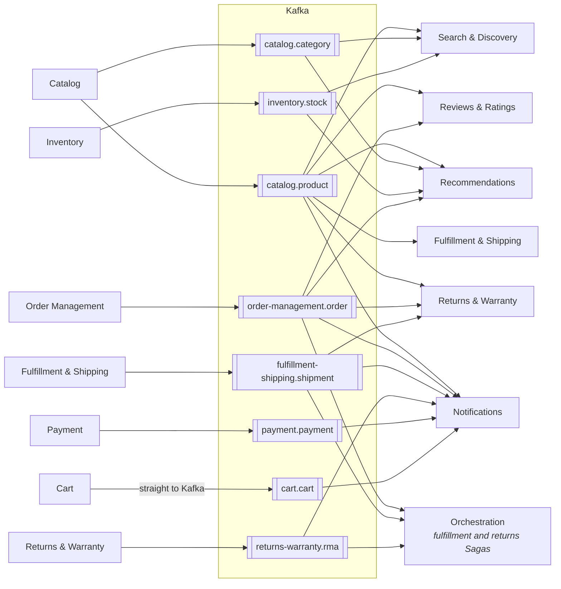
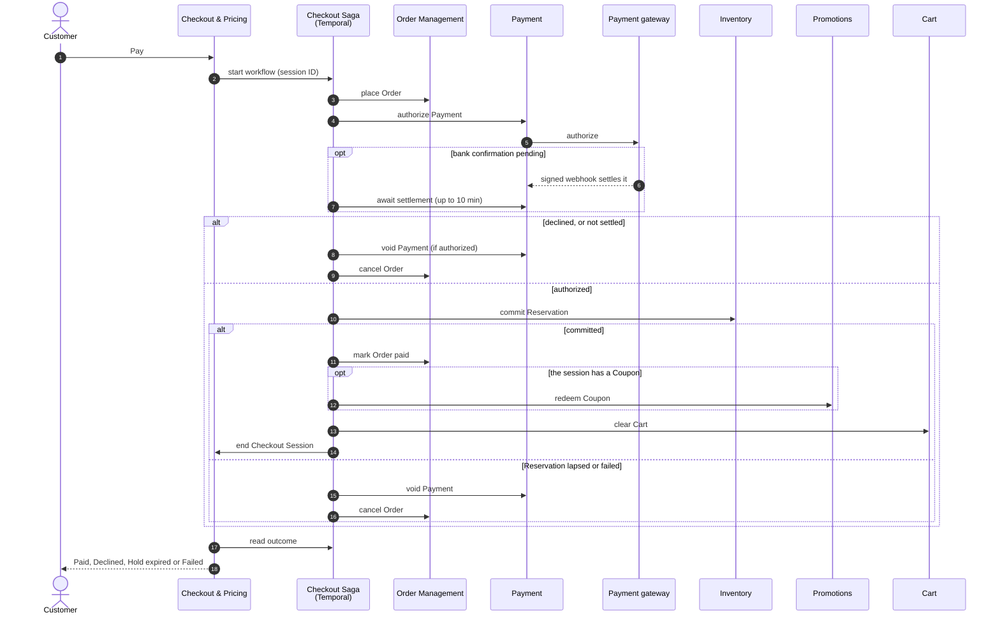
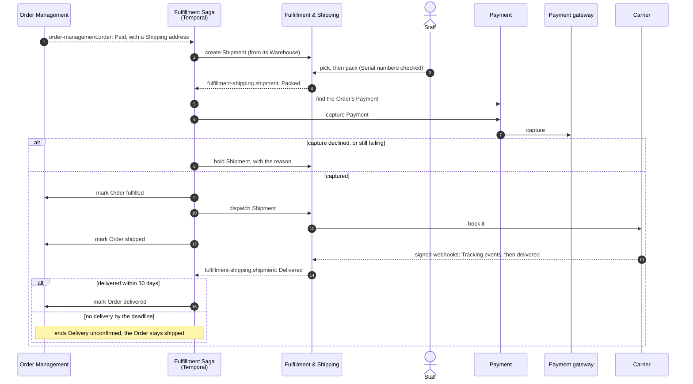
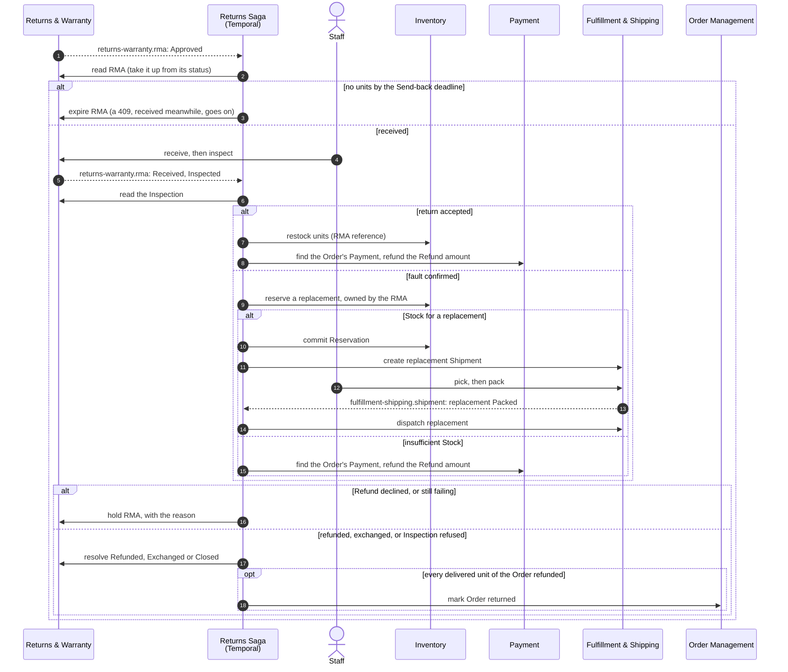

# Architecture

Six views of the running stack as of Sprint 8, still in progress: how browsers reach the services,
how the contexts call each other, what flows over Kafka, how the checkout Saga pays for a Checkout
Session, how the fulfillment Saga takes a paid Order to its Customer, and how the returns Saga takes
an approved RMA to its resolution. [`GLOSSARY-MAP.md`](../GLOSSARY-MAP.md) is the
source of truth for the relationships. Update these diagrams when a relationship there changes.

## Requests

Browsers reach the services only through the API gateway, which rejects a missing or invalid token
at the edge ([ADR 0010](./adr/0010-api-gateway-authenticates-at-the-edge.md)). Every service still
checks the Keycloak-issued JWT itself. Each service shows the store it owns. The gateway routes
Payment's reads by Customers and Staff, and the payment gateway's signed webhook, but none of the
commands only Orchestration makes. The Carrier's signed webhook reaches Fulfillment & Shipping the
same way, without a token, and so does a Cart reminder's unsubscribe link, a signed link to
Notifications' `GET` and `POST /unsubscribe/cart-reminders` whose token Notifications checks. The
Support Assistant is routed at `/api/support-assistant/`. Notifications sends its emails over SMTP
to Mailpit.

## Calls between contexts

Contexts call each other's internal endpoints, which the gateway never routes, each with its own
client-credentials identity
([Identity ADR 0002](../services/identity-access/docs/adr/0002-service-identity-by-client-credentials.md)).
Checkout calls five contexts to start and change a Checkout Session, and starts the checkout Saga
to pay one. Orchestration starts the fulfillment Saga itself, from a paid Order's event, and the
returns Saga from an approved RMA's. The Sagas' workers then send each step's command.
Notifications reads what an email needs that no event carries: a Cart before reminding its
Customer, each line's Price and Stock from Search, a Warehouse's Return address, and each
Customer's email address from Keycloak's admin API. The Support Assistant reads five contexts'
Customer reads directly, not through the gateway, with the asking Customer's own token
([its ADR 0002](../services/ai-support-assistant/docs/adr/0002-reads-with-the-customers-own-token.md)).

## Events

Every event is published to a compacted topic named after its schema
in [`platform/event-schemas`](../platform/event-schemas/)
([ADR 0002](./adr/0002-ledgers-and-outboxes-not-event-sourcing.md),
[ADR 0006](./adr/0006-kafka-as-single-event-backbone.md)), from its context's outbox, except Cart's
`cart.cart`: an Abandoned Cart goes straight to Kafka, since Redis has no outbox, with an ID a
consumer dedupes (ADR 0002's 2026-10-25 note). Consumers keep the newest version of
each entity and never call the publisher. Each consumer group, listed in
[`infra/docker/consumer-groups`](../infra/docker/consumer-groups), has its own `<group>.dlt` and
`<group>.redrive` topics. Commands never travel over Kafka.

Fulfillment & Shipping and Returns & Warranty appear twice, as a publisher on the left and a
consumer on the right, to keep the arrows one way. Orchestration consumes `order-management.order`
to start a paid Order's fulfillment Saga, `returns-warranty.rma` to start an approved RMA's returns
Saga and wake it, and `fulfillment-shipping.shipment` to wake either: an Order's Shipment wakes its
fulfillment, a replacement wakes its RMA's returns Saga. It publishes nothing. Notifications
consumes six topics and publishes nothing: Orders, Shipments, Payments' Refunds and RMAs each record
the Notifications their Message types name, `catalog.product` gives it Product names and Prices'
changes, and `cart.cart` a Cart reminder for a Customer who turned them on.

## Paying a Checkout Session

Paying starts the checkout Saga on Temporal, with the session's ID as the workflow's ID
([ADR 0009](./adr/0009-sagas-on-temporal.md)). Checkout already holds the Cart's Stock in a
Reservation. The Saga compensates a failure by voiding an authorized Payment and cancelling the
Order. Redeeming the session's Coupon, clearing the Cart and ending the session come after the
Order is paid. If one fails, the failure is logged and the Order stays paid.

## Fulfilling a paid Order

A `Paid` Order with a Shipping address starts its fulfillment Saga, `fulfillment:<orderId>`, once
however often its event is delivered ([ADR 0009](./adr/0009-sagas-on-temporal.md)). Staff pick and
pack the Shipment in the Admin Console; the Saga waits for each change on
`fulfillment-shipping.shipment`, and reads the Shipment again now and then in case an event never
comes. The Payment is captured only once the Shipment is packed. Once it is captured nothing is
compensated: each later step is retried until it succeeds. A declined capture holds the Shipment
for good and leaves the Order `Paid`.

## Resolving an RMA

Returns & Warranty takes a Customer's RMA, a return within the Return Period or a warranty claim
within the Warranty Window, only against units its projection of `fulfillment-shipping.shipment`
shows were delivered. Staff approve or reject it. An approved RMA starts its returns Saga,
`returns:<rmaId>`, once however often its event is delivered
([ADR 0009](./adr/0009-sagas-on-temporal.md)). The Saga reads the RMA first and takes it up from
its status, then waits on the RMA's events: for its units until the Send-back deadline, a durable
timer, and for Staff's Inspection with no deadline, reading the RMA again each hour in case an
event never comes. Once units are restocked or a replacement's Stock committed nothing is
compensated: each later step is retried until it succeeds. A declined Refund holds the RMA for good.

## Not built yet

Sprint 8, in [`docs/roadmap.md`](./roadmap.md), adds `storefront-ssr`, which renders the
Storefront's public pages on the server behind its nginx, and an AWS environment on EKS. Both
are left out until they are built. Prometheus and Grafana scrape every service, and are left out
of the diagrams.
